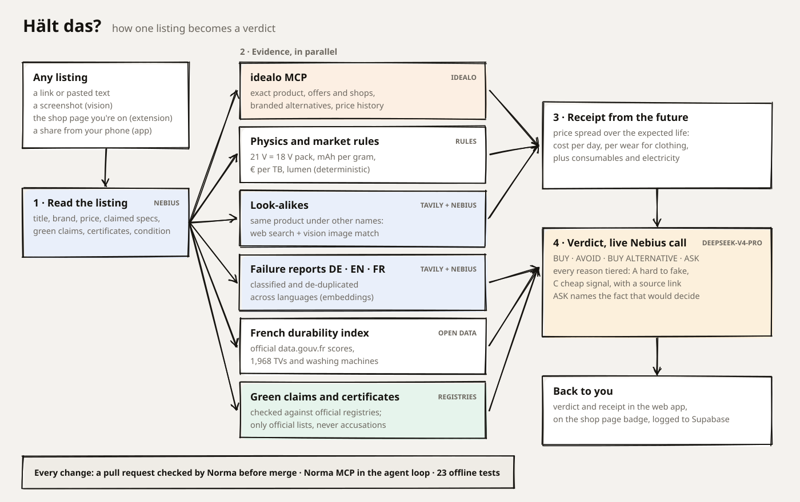

<div align="center">

# ⏳ Hält das?

### Know what lasts, before you pay.

**Checks any product listing the way an experienced buyer would: will it last, what does it really cost per day,
and is someone trying to trick you?**
**Every reason is tiered by how hard it is to fake, and a live Nebius call makes the decision.**

[](https://competent-studied-tumor-informal.trycloudflare.com/?replay)


Agentic Hackathon Berlin (AI Agents Berlin) · 27 Nov 2026 · built in one day

</div>

> **Try it:** open the [live demo](https://competent-studied-tumor-informal.trycloudflare.com/?replay) and click
> **„21V" drill**, then **LG OLED TV**. Each one replays a real live run (idealo, Nebius, Tavily) recorded on
> 27 Nov 2026, sped up to about 10 seconds. The public link runs **replays only**, so no API credits are spent, and
> it is up while the builder's laptop is on. Live checks of your own listings: [run it locally](#run-it-locally).

<p align="center"></p>

## The idea

Stars and prices don't tell you how long something lasts. A cheap drill with 4.7 stars comes back under eight brand
names, a "2 TB" stick for €16 fakes its size, and "sustainable" on a €7.99 T-shirt is just a word. Mozilla's Fakespot
used to check reviews; it shut down in 2025. Hält das? (German for *"will it last?"*) checks the listing before you
pay, and says when it doesn't know.

| Without | With Hält das? |
|---|---|
| The sticker price | **Cost per day** (or per wear) over the life you can expect, next to idealo alternatives |
| 4.7★ from 1,832 reviews | Reasons tiered **A** hard to fake (physics, official data, many shops) to **C** cheap signal (stars) |
| "21V", "50,000 mAh", "2 TB" taken at face value | Physics and market rules: 21 V is an 18 V pack, 2 TB for €16 is €8/TB |
| A confident answer either way | **ASK** when evidence conflicts, naming the one fact that would decide |
| "Eco", "climate-neutral" | Green claims checked against official registries; vague ones marked unproven |

## How it works

1. **You** hand over a listing: a link, pasted text, a screenshot, the shop page you're on (browser extension), or a
   share from your phone (installable app). *"Brushless Akkuschrauber Set 21V … 4,7 Sterne (1.832 Bewertungen), 39,99 €"*
2. **A Nebius model reads it**: title, brand, price, claimed specs, green claims, certificates, condition.
3. **Evidence, in parallel**: idealo MCP (exact product, shops, branded alternatives, price history) · deterministic
   physics and market rules · look-alike search (Tavily + vision image match) · failure reports in German, English and
   French (classified, de-duplicated with embeddings) · the official French durability index (1,968 models) · green
   claims against certificate registries.
4. **The receipt from the future**: price plus running costs spread over an evidence-based life range.
5. **The verdict**: a live call to `deepseek-ai/DeepSeek-V4-Pro-0813` on Nebius Token Factory returns the verdict,
   tiered reasons with source links, a better alternative and the missing fact.

| Verdict | Example (recorded run) | Why |
|---|---|---|
| **BUY ALTERNATIVE** | No-name „21V" drill, €39.99 | not sold by any idealo shop, 21 V = 18 V pack, 8 look-alike brands, early failures; €0.35/day vs Bosch at €0.02/day |
| **AVOID** | „2 TB" USB stick, €15.99 | €8/TB, far below genuine flash; fake-capacity pattern |
| **ASK** | LG OLED77B65LA, €1,799 | official French index 8.0/10 vs B-series failure reports; asks whether this model shares the failing board |
| **ASK** | „Eco" T-shirt (fictional demo brand), €7.99 | 3 green claims unproven, no certificate listed; €0.03 per wear |

## Demo script

The spoken video script with timings is in [`DEMO_SCRIPT.md`](DEMO_SCRIPT.md): problem, solution, then the four cases
above. Every number in it matches the recorded runs in `samples/batch/`.

**Questions we expect**
- *Is the life estimate made up?* It is a range from evidence plus model judgement, pulled down by failure reports and
  anchored on official indexes where they exist; the receipt prints the basis.
- *Same product, other names: proven?* No. Look-alikes are shown with sources as candidates, never as proof.
- *Defamation?* The agent only repeats official listings and named sources, and never accuses a brand on its own.

## Stack

| Layer | Tech | Why |
|---|---|---|
| Market data | **idealo MCP** (own OAuth client, `app/idealo.py`) | shops, alternatives and prices turn "cheap" into cost per day |
| Models | **Nebius Token Factory**, one gateway `app/llm.py` | every call logged and shown in the UI; the decision is a live call |
| Web evidence | **Tavily** search + extract | failure reports and look-alikes in three languages, with URLs |
| Official data | data.gouv.fr durability index (CSV, 1,968 models) | tier-A evidence that a seller cannot write |
| Server | **FastAPI**, Server-Sent Events | the evidence streams in step by step |
| Clients | web app (installable PWA with share target), Chrome MV3 extension | check where people shop |
| Storage | **Supabase** (PostgREST) | log of every check |
| Code quality | **Norma** GitHub App + Norma MCP | every PR checked before merge; checks inside the agent loop |

<details><summary>Models and where the call decides (Nebius note)</summary>

| Step | Model |
|---|---|
| Read listing / screenshot | `Qwen/Qwen3-30B-A3B-Instruct-2507`, `google/gemma-3-27b-it` (vision) |
| Look-alike image check | `google/gemma-3-27b-it` |
| Classify failure reports | `Qwen/Qwen3-30B-A3B-Instruct-2507` |
| De-duplicate reports across languages | `Qwen/Qwen3-Embedding-8B` |
| Lifetime and running-cost estimate | `Qwen/Qwen3-30B-A3B-Instruct-2507` |
| **Final decision (live)** | **`deepseek-ai/DeepSeek-V4-Pro-0813`** (fallback `deepseek-ai/DeepSeek-V4.1-Flash-1017`), `app/pipeline.py → verdict()` |
</details>

**Enforced:** API keys only in `.env` (never committed; history scanned before the repo went public) · the public
link serves replays only (`HAELTDAS_REPLAY_ONLY=1`) · the UI escapes all model output · replay never silently runs
live · the service worker never caches `/api/*`.

## Repo layout

```
app/          pipeline (evidence + verdict), Nebius gateway, idealo client, rules, French index, server
web/          the web app (single page), PWA manifest, service worker, icons
extension/    Chrome MV3 extension: product-page badge, side panel
tests/        29 offline tests: one per demo listing, plus replay matching
samples/batch recorded live runs (used by replay)
data/         French durability index (consolidated CSV) and findings
scripts/      idealo OAuth login, batch runs, Supabase backfill
demo/         video pipeline (Modal TTS and render, screen recording)
docs/img/     architecture diagram
```

## Run it locally

```bash
python3 -m venv .venv && .venv/bin/pip install -r requirements.txt -r requirements-dev.txt
python3 scripts/idealo_mcp.py login          # idealo MCP OAuth (callback port 6274)
# .env: NEBIUS_API_KEY=…  TAVILY_API_KEY=…  (optional) SUPABASE_URL=…  SUPABASE_SERVICE_KEY=…
.venv/bin/uvicorn app.server:app --port 8787  # live checks at http://127.0.0.1:8787, replays at /?replay
.venv/bin/python -m pytest -v                 # 29 passed
```

Browser extension: `chrome://extensions` → Developer mode → *Load unpacked* → `extension/`.
Public replay-only link: `HAELTDAS_REPLAY_ONLY=1 uvicorn app.server:app --port 8788` behind
`cloudflared tunnel --url http://127.0.0.1:8788`.

## Limits

- idealo Trial tier: review summaries only; per-review fake detection needs the Partner tier.
- Life estimates are ranges, not measurements; web evidence is thin for brand-new products (then: **ASK**).
- The public link is a Cloudflare quick tunnel to a laptop, replays only.

**What's next:** hosted deployment · per-review fake detection (idealo Partner tier) · more official indexes
(EU energy label, repairability) · price-history timing ("wait a week")

---

Built at the Agentic Hackathon Berlin by kaiser-data, with Claude Code and the Grok Build agent as coding agents
(Codex and Grok as reviewers) and Norma checking every pull request. Design notes: [`DESIGN.md`](DESIGN.md) ·
submission: [`SUBMISSION.md`](SUBMISSION.md) · French index findings: [`data/FR_DURABILITY_INSIGHTS.md`](data/FR_DURABILITY_INSIGHTS.md).
Never commit `.env` or `.idealo_token.json`.
