# Hält das? (*"Will it last?"*)

**What a product really costs per day, how long it lasts, and whether someone is trying to trick you.**

Paste a link, a description, or a screenshot of any listing (Amazon, Temu, an Instagram ad). An agent checks it the way an
experienced buyer would and prints a *receipt from the future*: the price per day over the life you can actually expect.

> I bought a cordless drill with 4.7★. Six weeks later the chuck broke. Then I found the same drill under other names.



How the pieces fit: [docs/ARCHITECTURE.md](docs/ARCHITECTURE.md).

## What it checks
| Check | How | Source |
|---|---|---|
| **Is it sold by real shops?** | exact match + branded equivalents, shop count, price | idealo MCP |
| **Do the specs add up?** | physics and market rules: "21V" = 18V nominal, mAh vs weight, €/TB for flash, lumen vs price, health claims | deterministic rules |
| **Same product, other names?** | look-alike listings, brand names, vision comparison | Tavily + Nebius vision |
| **Does it break?** | failure reports in DE/EN/FR, classified, de-duplicated across languages | Tavily + Nebius LLM + embeddings |
| **What does it cost per day?** | price + running costs over an evidence-based life range | idealo + Nebius |
| **Verdict** | BUY / AVOID / BUY_ALTERNATIVE / ASK, each reason with an evidence tier and a source link | live Nebius call |

Evidence tiers: **A** hard to fake (independent tests, many shops, physics, official data) · **B** filtered user reports ·
**C** cheap signals (star average, review count, marketing). Country of origin is never a signal; throwaway brands are.

## Run it
```bash
uv venv .venv && uv pip install -p .venv -r requirements.txt
python3 scripts/idealo_mcp.py login          # idealo MCP OAuth (port 6274)
# .env: NEBIUS_API_KEY=…  TAVILY_API_KEY=…
.venv/bin/uvicorn app.server:app --port 8787  # open http://127.0.0.1:8787
```
Browser extension: `chrome://extensions` → Developer mode → *Load unpacked* → `extension/`. Click the icon on any product page.

## Nebius Token Factory: models and where the call decides
| Step | Model |
|---|---|
| Read listing / screenshot | `Qwen/Qwen3-30B-A3B-Instruct-2507`, `google/gemma-3-27b-it` (vision) |
| Clone check (image vs image) | `google/gemma-3-27b-it` |
| Classify failure reports | `Qwen/Qwen3-30B-A3B-Instruct-2507` |
| De-duplicate reports across languages | `Qwen/Qwen3-Embedding-8B` |
| Lifetime + running-cost estimate | `Qwen/Qwen3-30B-A3B-Instruct-2507` |
| **Final decision (live)** | **`deepseek-ai/DeepSeek-V4-Pro-0813`** (fallback `deepseek-ai/DeepSeek-V4.1-Flash-1017`) in `app/pipeline.py: verdict()` |

Every call goes through `app/llm.py` and is shown in the UI's call log (model, latency, tokens).

## Limits (honest)
- idealo Trial tier: review summaries only; per-review fake detection needs the Partner tier.
- Life estimates are ranges from evidence plus model judgement, not measurements.
- Web evidence can be thin for brand-new products; then the agent answers **ASK** and names the missing fact.
