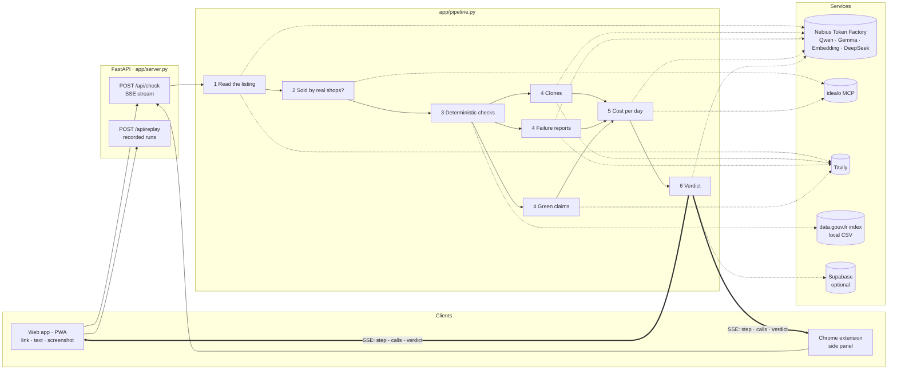

# Architecture

*The orange dot is one listing moving through a check. Each stage lights up the services it calls. The result
streams back to the UI as Server-Sent Events.*

## Flow
1. **Clients.** The web app (an installable PWA with a share target) or the Chrome extension side panel sends a link,
   pasted text, a screenshot, or the open product page to `POST /api/check`.
2. **Server** (`app/server.py`). FastAPI streams every pipeline event back as Server-Sent Events. `POST /api/replay`
   replays recorded runs from `samples/batch` (the public demo uses it, so no API credits are spent).
3. **Pipeline** (`app/pipeline.py`):

   | Stage | What happens | Uses |
   |---|---|---|
   | 1 Read the listing | Extract title, brand, model, price, claimed specs | Tavily extract, Nebius Qwen / Gemma vision |
   | 2 Sold by real shops? | GTIN or exact match, branded equivalents, shop count and price | idealo MCP |
   | 3 Deterministic checks | Physics and market rules, "sold as broken", French durability index | `app/rules.py`, `app/fr_index.py` (local CSV) |
   | 4 Evidence in parallel | Clones (image search + vision), failure reports (DE/EN/FR, classified and de-duplicated with embeddings), green claims (certificates, EU Safety Gate) | Tavily, Nebius |
   | 5 Cost per day | Life range and running costs, alternatives priced | Nebius, idealo |
   | 6 Verdict | BUY / AVOID / BUY_ALTERNATIVE / ASK, each reason with an evidence tier and a source | Nebius DeepSeek-V4-Pro (live) |

4. **Storage.** If `SUPABASE_URL` and `SUPABASE_SERVICE_KEY` are set, `app/store.py` saves the check.

Every model call goes through `app/llm.py`. Each one is logged (model, latency, tokens) and shown in the UI's call log.
A failing evidence branch in stage 4 never blocks the verdict: it is reported as an error and the agent decides with
what it has, answering **ASK** if the evidence is too thin.

## Same flow as a Mermaid diagram

