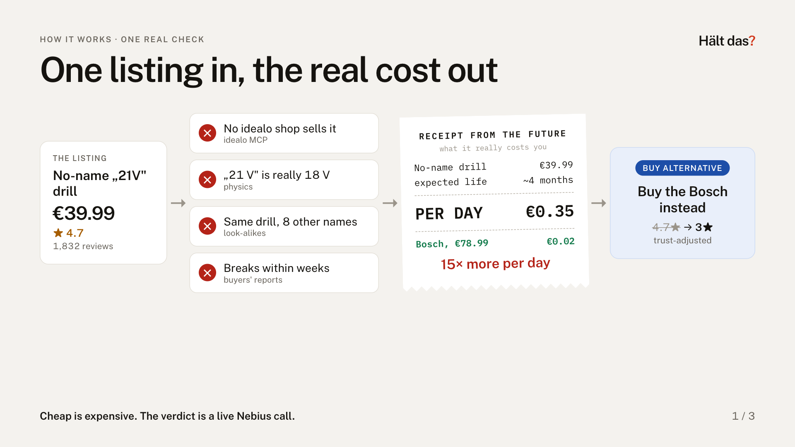
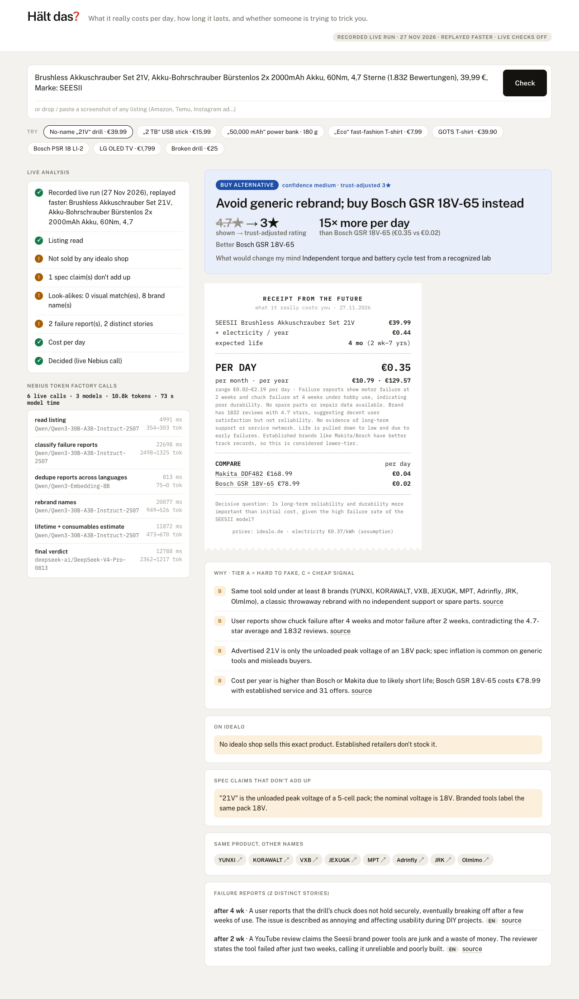

# Hält das? A Receipt From the Future for Cheap Products

*Write-up after the Agentic Hackathon: From Research to Commerce (AI Agents Berlin, 27 Nov 2026). Written after the submission; the submitted code is the state of `main` at 19:30.*

Picture a cordless drill: 4.7 stars, forty euros. Within weeks it breaks, and the same drill turns up under other brand names.

At the **Agentic Hackathon: From Research to Commerce** by AI Agents Berlin at The Delta Campus, we built the tool we wanted that day: **Hält das?** ("Will it last?"). It answers one question before you pay: which option gives you the best quality for your money?

## Cheap is expensive

A €39.99 drill that lasts about four months costs **€0.35 a day**. A €78.99 Bosch that lasts about ten years costs **€0.02 a day**. The "cheap" one is fifteen times more expensive.

Star ratings don't show that: this drill had 4.7 stars from 1,832 reviews. And the best-known fake-review checker is gone: Mozilla shut down Fakespot in July 2025.

## One drill, five checks

Paste the listing. Hält das? checked it the way an experienced buyer would:

1. **idealo:** no idealo shop sells this exact drill. The Bosch GSR 18V-65 is there for €78.99, with 31 offers.
2. **Physics:** "21V" is the unloaded peak of a five-cell pack. Branded tools sell the same pack as 18V.
3. **Other names:** the same tool shows up under eight more brand names.
4. **Other buyers:** failure reports in German, English and French, including a report of the chuck failing after about four weeks.
5. **The receipt from the future:** the price spread over the life the evidence supports.

Then a live call to DeepSeek-V4-Pro on Nebius Token Factory decided: **buy the alternative.** Trust-adjusted rating: 4.7★ → 3★. When the evidence conflicts, it doesn't force a verdict: it answers ASK and names the one fact that would decide.

## Best quality, in the code too

A tool that judges whether products hold up should hold up itself. **Norma by Quality Clouds** checked every pull request before it was merged: 14 of them, written with two coding agents (Claude Code and the Grok Build agent).

- The browser-extension PR went **6 → 2 → 1 → 1 → 0** issues. Each step fixed a cause; nothing was deleted to make a finding go away.
- Twice, Norma's own rules pulled against each other: "don't swallow errors" against "no console logging", and "no unbounded Promise.all" against "no await in a loop". Both times the answer was a better design (one diagnostics channel, a bounded batch), not a workaround.
- One finding stays on purpose: a broad exception around the evidence searches, so one blocked shop can't kill the verdict. The error is kept and shown, and the agent answers ASK.
- The Norma MCP ran inside the agent's loop: open findings in, fix, live check clean, the result written to Norma's audit trail.

Cheap products fail quietly. So does cheap code. Both need evidence.

## The partners' tech did real work

- **idealo MCP** is the reality check: who sells it, which branded alternatives exist, what they cost.
- **Nebius Token Factory** runs every model step: Qwen3 reads the listing and classifies failure reports, Gemma 3 compares product photos, Qwen3-Embedding merges duplicate reports across languages, and DeepSeek-V4-Pro decides. Every call shows on screen with model, latency and tokens.
- **Norma by Quality Clouds** kept the code defensible, as above.

## Try it

The demo replays recorded live runs, so it costs no API credits: https://haelt-das.martinkaiser-bln.workers.dev. The code is open.

Working on consumer protection, repair or second-hand commerce? I'd love to try it on your listings. Message me or comment "hält das".

## Thank you

To **AI Agents Berlin** for the event, to **The Delta Campus** for the venue, and to **idealo**, **Nebius** and **Norma by Quality Clouds** for challenges that pushed the build in useful directions.

